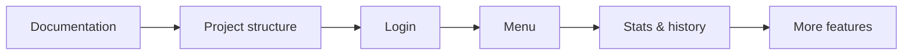

# Roadmap

> This roadmap is a work in progress. The order and details can still change.

## 1. Project setup

- [ ] Complete the documentation.
- [ ] Set up the backend and frontend folder structure with empty folders. No implementation yet.

## 2. Login

- [ ] Implement the login backend.
- [ ] Design the login screens.
- [ ] Build the login frontend on top of the backend.
- [ ] Style the frontend according to the design.

## 3. Features

Repeat the login process for each feature: backend, design, frontend, and styling.

- [ ] Menu
- [ ] Stats and history
- [ ] User settings
- [ ] Playlists
- [ ] Friends tab
- [ ] Song League
- [ ] Private sharing
- [ ] Compare playlists
- [ ] Admin panel
